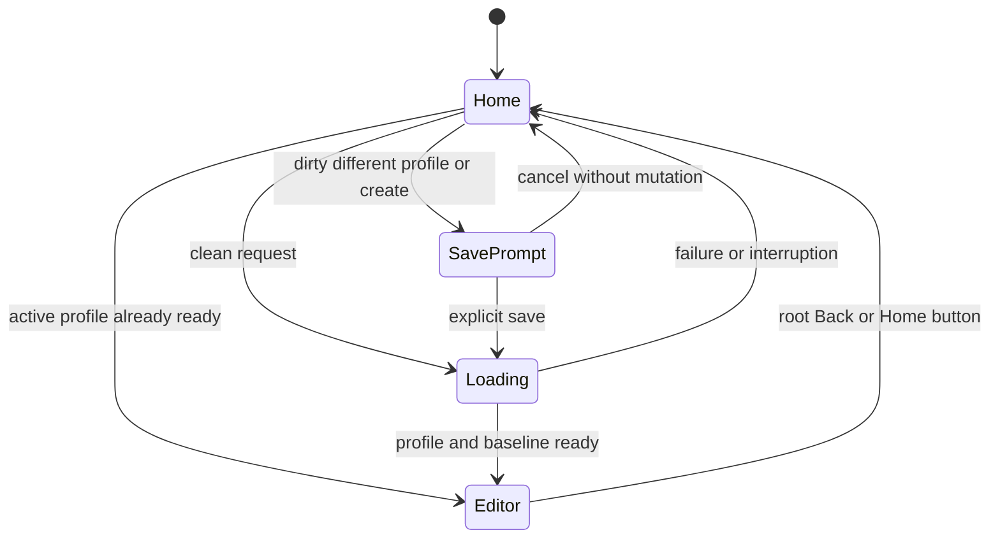
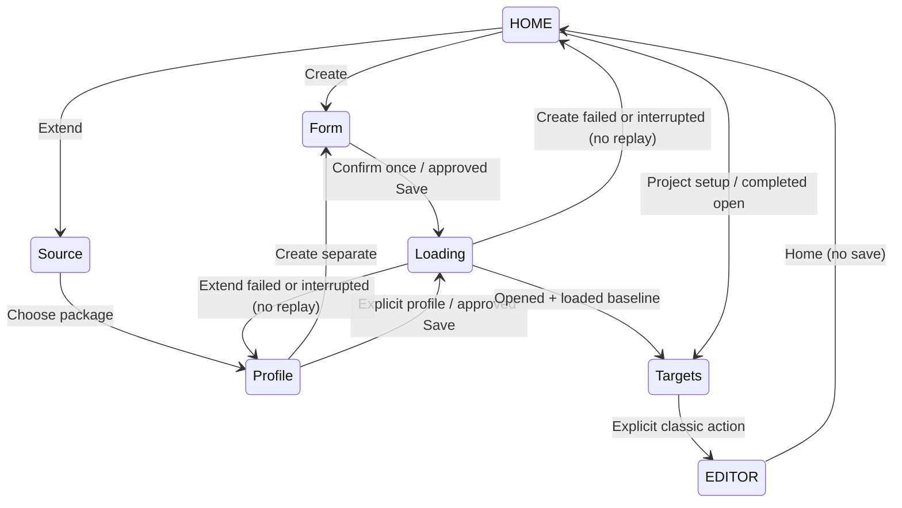
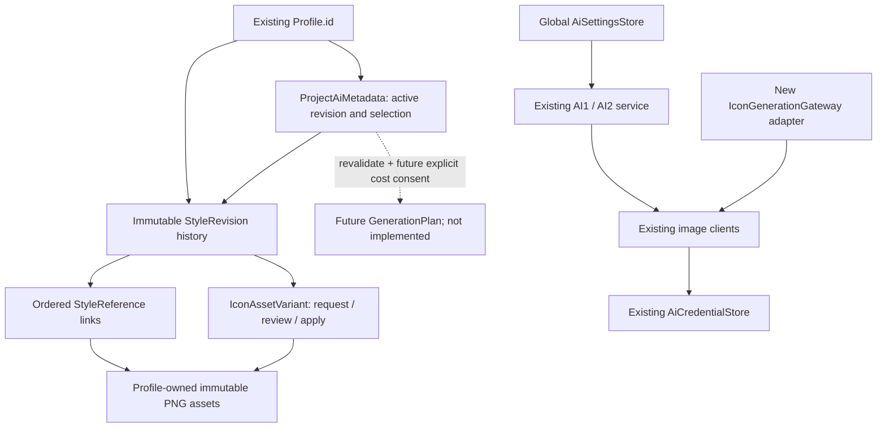
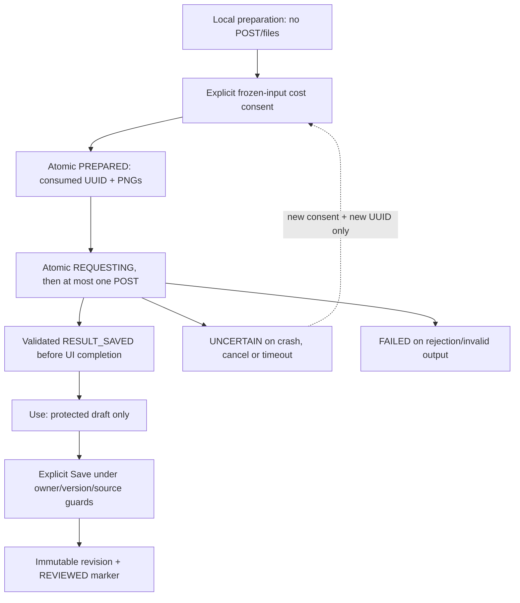
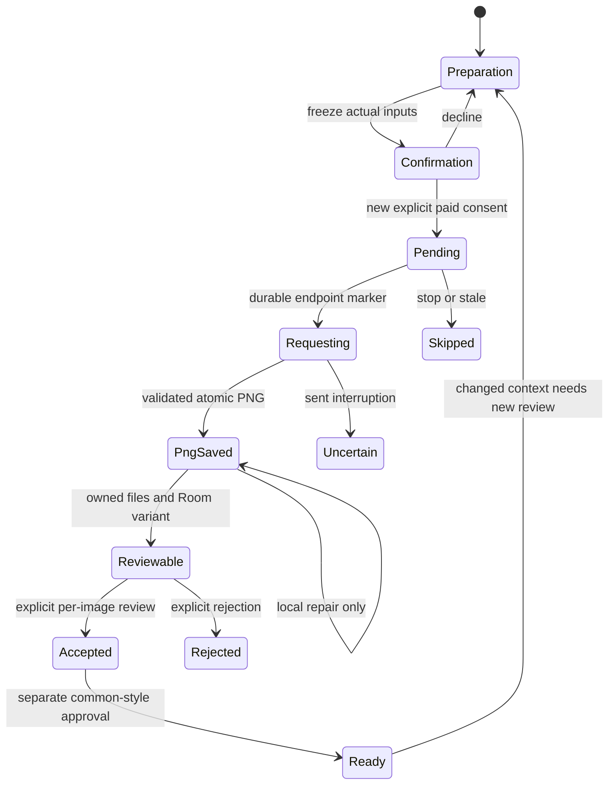

# Architecture

## Guided presentation and ownership

`RenkinAiRoot` enables the four-step shell without changing classic editor or intent
priority. The shell stores routes only. `ProjectWorkflow` derives source readiness
and completion from existing metadata, saved revisions and owned trial state.
`TargetSelection` hydrates current saved keys and awaits the existing durable save
before advancing. Default API-compatible shell consumers remain supported.

`ProjectStylePanel` owns the local editable draft; the selected aggregate/DNA child
propagates dirty and saving state. DNA/aggregate saves return a persisted
`SavedProjectStyle` before parent synchronization/navigation. Per-record source
validity is separate from current operation errors. Nothing converts legacy styles.
`trialReviewSummary` checks all current successful variants, owner/context/request
proof and current failures before exposing approval. History presentation does not
remove journal or Room evidence. Completion performs read-only local revalidation.

Owned controllers remain the only async request owners. `OwnedStyleTrials` coalesces
a latest local load for another profile while its authorized network operation runs;
release/context guards drop obsolete routes. The drain calls only `load`, never
prepare/submit. Existing session mutexes, consumed markers, uncertain recovery,
immutable original/RAW assets, repository transactions and one-shot gateways remain.
No database, global lifecycle singleton or second request coordinator was added.
See [ADR0009](decisions/0009-guided-project-workflow.md) and the
[implementation inventory](changes/2026-10-14-guided-ux-implementation.md).

## Earlier checkpoint records

The dated evidence below is historical; it does not replace the local guided UX checks.

## Current opt-in Style DNA architecture

Separate stacked PR7 adds diagnostics, individually labeled reports, independently validated
family synthesis, typed editable revision evidence and a target-specific recipe compiler.
Quick1 and Standardup-to5 one-shot submissions use their own durable consumed-step journal.
Only a consciously reviewed immutable revision enters M5; original componentC supplies
identity at the existing native request factory. Stable opaque interiors improve new
family palette measurement without changing legacy aggregate measurement. Room21,
full/shareformat6/payload3 and historical optional JSON/fingerprints remain compatible.

The code architecture is regression-verified at89eacb0d (925 tests/all22 groups).
Provider visual quality and device/signing acceptance remain separate. See
[ADR0008](decisions/0008-style-dna-stacked-development.md) and
[closed scope](changes/2026-10-14-style-dna-verification.md). Earlier records below
retain their original dates/results.

Checkpoint73cd29e8 / Android38434288813 compiled and ran897 tests with exactly one new neutral-tile policy failure; all previous/new original, wire, journal and UI tests passed. The follow-up distinguishes recurring neutral/background mass from varying significant chromatic accents, preserving brand colors even when the tile dominates area. Genuine final-head results and all21 XML/benchmark evidence are recorded in PR#6.


Implementation checkpoint ab80db86 / Android38433644576 stopped at production compilation: nullable Resources.getDrawableForDensity result needs explicit fail-closed handling. No Android assertions/APK ran at that head. The follow-up preserves the resource-only contract, adds missing/disabled/wrong-user originals and a neutral-tile brand-accent regression, and strengthens source-switch multipart fixtures with distinct B2 bytes. Final executed results remain in PR#6.


## October13 style fidelity and component original refinement

Owner comment6149883090 is implemented incrementally on PR#6 from422ef578. Local EXTEND now inspects up to300 mappings and selects proportional geometry-family medoids plus minority checks, with real alpha-aware Oklab palette swatches and measured roles/prevalence/distributions. Varied native logo hues alone are not mixed drawing styles; fixed palettes require recurring evidence. Advanced shows bounded local measurements separately from model inference. Cloud remains one separately confirmed low-detail request, same model/V1 schema, <=12 thumbnails/4MiB; manual CREATE and0–5 ordered generation refs remain.

M5 already used exact component icons independently of EXTEND. It now resolves the enabled current-user component declared full resource, compares activity API bytes, freezes optional versioned evidence and displays Original app icon separately from the style pack. OEM overlays remain possible: new resource originals display UNVERIFIED_ORIGINAL and require conscious plan-specific verification before separate paid consent. Missing resource fails closed. Equal bytes retain old origin stamps and historical approvals; real differences/version/config changes stale the plan. Source packs provide style/coverage only. Legacy editor, AI1/AI2, Roomv21, backup/history, keys/build/install and M6 read-only guards remain.

Actual test-first red95cd7786:144 XML/883 tests/4 failures/0 errors/skips; red812bc7da:144 XML/885 tests/5 failures/0 errors/skips, all new regressions only. Final-head automated/XML/benchmark/APK evidence is recorded in PR#6 after execution. No live API call or physical device run. [ADR0007](decisions/0007-style-fidelity-and-component-originals.md) defines the current boundaries. PR remains draft/open/unmerged for owner verification.

## OpenAI single-target output contract — October 13

PromptComposer.openAiTrialAppearance validates saved style/project/app text without
nested escaping. openAiEditPrompt is the one authoritative OpenAI target/edit/output
assembler: original image1, ordered style-only2..N, no borrowed reference symbols,
one centered transparent1024 PNG and explicit collage exclusions. All appearance
data, including MIXED categories/brand observations/conflicting instructions, is
quoted below this precedence. Essential target typography is allowed. The full
escaped body is bounded to32000; gateway preflight and frozen-plan validation share
the same helper. The native OpenAI multipart factory always assembles it for a
non-null override, preventing a raw M5 override from dropping the contract.

Null overrides still call the untouched historical iconPrompt; reference order,
fields/options/n=1 and one-shot transport bytes remain. Stability uses the previous
composeSaved prompt and separate init_image/style_image/background endpoints,
exactly one reference and distinct endpoint counters. No analysis/vision retry or
new model call, schema, stored revision/approval mutation or automatic regeneration.
PNG validation remains structural, not collage/logo classification. ADR0006 and
the [corrective note](changes/2026-10-13-single-icon-trial-contract.md) record this
boundary; device artwork acceptance is separate from actual automated evidence.

## October 13 corrective boundaries

Keep the existing Activity VM, shell, owned controllers, Room v21 and format6.
The correction has no migration, package, source-parser, signing, install or AI1/AI2
controller change. STYLE trial entry is visible above analysis; TARGETS reads its
existing saved metadata to gate trials, and the existing TRIAL Back/targets route
returns to preparation. These UI prerequisites never authorize a POST.

The shell passes null sourceStamp when opening STYLE for CREATE, regardless of
available coverage input. For EXTEND it accepts only a snapshot matching the chosen
profile and source package. An irrelevant snapshot must not cause saveRevision to
erase compatible target selection; genuine context-change invalidation stays intact.

OwnedStyleTrials emits bounded local prerequisite codes instead of exception text.
The analysis adapter retains safe HTTP400/402/422 rejection status and only the
allowlisted insufficient_quota code; no raw server body enters journals or UI.
Schema maxItems6/maxLength160/800 matches the unrelaxed Kotlin checks. Official
structured-output docs support these restrictions for the existing non-fine-tuned
gpt-5.4-mini; the separate one-shot/consumed-consent boundary is retained.

AtomicFile base or backup existence is readable durability; .new-only plans and
consumed item markers are reservations, never permission. Orphan plans count against
the existing 256-plan quota and cannot reuse their UUID. Partial image writes can
be rewritten only from freshly consented immutable inputs; .new-only results never
claim a completed charge or PNG. Fresh result insertion atomically invalidates the
revision approval; idempotent installation does not. Accepted reads also check all
current successes, closing stale or restored approval gaps. ADR0005/0006 record this.

Only an explicitly authorized one-request Python contract probe was live: synthetic
artwork, HTTP200/618 tokens, no inventories. It does not certify Android, the owner's
source pack, image generation, Samsung behavior or provider quality.

> Personal AI fork: see [AI_FORK_HU.md](AI_FORK_HU.md). The Kotlin namespace stays upstream;
> the installed app ID is `hu.zsombor.renkinai` (`.dev` for debug), generated packs use
> `${BuildConfig.APPLICATION_ID}.pack` plus per-profile suffixes. Single-icon AI accepts through the upload
> draft. AI batches fill missing slots through ApplicationProvider’s profile-gated custom-render/edit/save
> operation and save each successful step; neither path replaces IconGenerator, Room serialization or the APK builder.

A guide for developers (and AI assistants) working on this codebase. The app builds
installable Android icon packs on-device.

Codex 04 source audit: October 12, 2026. Accepted base is owner-merged PR #4
`6aed9e08ee5619c1061481972dc172546c7f5abe`; code head 47503e5c on
`feat/automatic-style-analysis-m4` is offline-verified: 792 tests, all groups/APK.
Owner merged #5 as af7bdb10 at 16:10:49 UTC on October 12. Final aceb691c
passed its own complete checks; provider/device acceptance is separate. M5 source
starts exclusively from that accepted main; head-specific evidence is in QA and PR #6.
Historical Codex 03 starting main was
`aefeb1b69e7757c757c60ac2f00ce2125893e1e6`, then `feat/project-ai-persistence-m3`.
Entry map: [INDEX](INDEX.md); implementation/limitations: [CURRENT_STATE](agent/CURRENT_STATE.md).
Codex 00–04 are owner-merged. Codex 04 adds a separate reviewed style-analysis path;
legacy editor/AI/build paths remain. Fresh feature evidence belongs in QA, not this
source description.

## Naming — read this first

Several names float around; this trips up newcomers:

| Thing | Value |
| --- | --- |
| App display name | **Renkin AI** (`res/values/strings.xml`) |
| Kotlin namespace / package | `dev.renkinProject.renkin` (upstream identity retained in code) |
| Installed application id | `hu.zsombor.renkinai`; debug adds `.dev` (`app/build.gradle.kts`) |
| Generated icon pack package | `${BuildConfig.APPLICATION_ID}.pack` (`IconPackBuilder.PACKAGE_NAME`); non-default profiles append `.p<profileId>` so several packs install side by side |
| External libraries | `dev.alembiconsProject.imagetracer`, `dev.alembiconsProject.tgCannyEdgeCompose` and the `com.github.Alembicons` gradle coordinates are **upstream libraries — never rename** |

It is a fork of **Alembicons** (formerly *Iconeration*). The upstream attribution
(InfoDialog F-Droid link, `aboutFork` strings) stays.

## Build & run

- JDK: the project targets **Java/Kotlin 17**.
- CLI build: `JAVA_HOME="D:/Android/jbr" ./gradlew compileDebugKotlin`
- Unit tests: `./gradlew testDebugUnitTest`
- Dependencies live in `gradle/libs.versions.toml` (version catalog) + `app/build.gradle.kts`.
  KSP is used for annotation processing (Room + Hilt) — prefer KSP over kapt.
- `.gitattributes` normalizes the repo to LF.

## Layers

```
Composables (ui/)                         ← stateless-ish views, read VM state, call VM funcs
        │  hiltViewModel()
        ▼
MainViewModel / WatchViewModel            ← @HiltViewModel; own session/UI state, orchestrate
        │                                    operations on viewModelScope
        ▼
ApplicationProvider (apk/)                ← orchestrator: owns the app list, profiles, refresh,
        │                                    build snapshots and persisted results
        ├── InstalledAppCatalog            ← launcher activities, labels and application icons
        ├── IconPackCatalog                ← installed icon-pack discovery and package metadata
        ├── IconPackRepository             ← installed packs, app-filter elements, per-app
        │     │                              drawables, calendar icons (Compose-state backed)
        │     └── ApplicationManager        ← icon-pack resources and appfilter XML only
        ├── IconGenerationService          ← runs IconGenerator to produce icons
        ├── IconPackBuildService           ← assembles/signs APKs and runs install/replace
        └── RenkinPackStore                ← persistence: DbApplication ↔ drawable serialization
                └── RenkinPackRepository    ← raw Room I/O on RenkinPackDatabase

WatchRepository (data/watch/)             ← icon-watch rules/suggestions on WatchDatabase
```

The UI layer never constructs repositories by hand; view models receive them through
Hilt. `getCurrentMainActivity()` is still used in a couple of places, but only for genuine
Activity operations (`finish()`, starting services, permission requests).

`ApplicationProvider` is the orchestration boundary, not the composition root. Hilt supplies
its repositories, stores, profile/lock managers, generation and pack-build services as
application singletons through `di/AppModule.kt`. AppModule constructs the provider's
ApplicationManager and InstalledAppCatalog; AI clients/stores use constructor injection.
Those collaborators can be tested or reused without constructing the whole provider,
and persistence state is shared deliberately.

## AI integration boundaries

- `AiSettingsStore` owns global provider/style/model/quality/reference preferences;
  these are deliberately outside profile-generation snapshots. `AiPromptStore`
  separately hashes profile/component for optional per-app instructions.
- `AiCredentialStore` holds encrypted provider credentials under `noBackupFilesDir`
  using unchanged Android Keystore aliases. Keys do not travel in full/profile backups.
- `OpenAiImageClient` sends original icon then references to Images Edits, one PNG
  per request; `StabilityImageClient` uses one reference and two calls. Neither path
  automatically retries billable requests. Model names are a source list, not a
  verified statement of present provider availability.
- `AiIconGenerationService` serializes generation, checks PNG dimensions/alpha,
  stores a 512 px PNG in UploadedImageStore, then saves a per-target fingerprint
  marker before returning preview. The gallery is under filesDir; markers are not
  backed up. Validation does not assess recognizability, lettering or visual quality.
- Single-icon acceptance feeds IndividualOptions' existing upload draft;
  MainViewModel applies it under its profile-session mutex, then normal Save/Build
  persists it. It does not replace the render/Room pipeline.
- Batch uses AiBatchViewModel → AiBatchRunner → AiBatchStore (AtomicFile journal,
  noBackupFilesDir). States are PENDING, REQUESTING, GENERATED, SUCCEEDED, FAILED,
  SKIPPED. A killed request without a matching saved PNG becomes uncertain/FAILED.
  Resume does not automatically resend failures; retry requires user confirmation.
- `ApplicationProvider.applyAiMissingIconAndSave` checks current profile, component,
  missing/lock state and then custom-renders, edits and saves the **whole** current
  profile under its operation gate. Every completed item persists before the next
  request. Existing icons are never batch targets. No AI WorkManager/foreground
  runner, server backend or billing is present. ProjectHome delegates to the classic
  editor and introduces no AI operation.

The gallery/cache/journal distinction and manual paid-request controls must survive
future UI work. See [AI_FORK_HU](AI_FORK_HU.md) for usage and [QA](qa/TEST_MATRIX.md)
for the device/process-death coverage still required.

## Activities

- **MainActivity** — provides `LocalMainActivity`/`LocalToaster`, instantiates its
  Activity-scoped MainViewModel before Composition, then renders RenkinAiRoot.
  Shared-image/watch intents request the editor in the same VM, preserving the
  original UploadedImageStore, Activity URI state key and onResume installer hook.
- **GlobalOptionsActivity** — wallpaper-backed Global options grid. It uses a lightweight
  view model over the shared provider and performs guarded provider initialization when Android
  recreates it in a cold process without MainActivity/MainViewModel.
- **WallpaperPreviewActivity** — the pack preview before a build. Its theme sets
  `windowShowWallpaper` + a transparent background so the system draws the real wallpaper
  behind it (the launcher trick — no permission; `WallpaperManager.getDrawable` is locked
  behind MANAGE_EXTERNAL_STORAGE since Android 13). It must be an activity: dialog windows
  never become the wallpaper target. It reads shared state from the `ApplicationProvider`
  singleton directly — deliberately **not** through a new `MainViewModel`, whose init would
  re-run provider initialization and drop unsaved icons. RESULT_OK = "user pressed Build";
  the launching side (BuildPackFab) runs the build. If Android recreates it alone over a killed
  process (`savedInstanceState != null` while `startupComplete == false`), the reviewed session
  no longer exists — `onCreate` closes it with `RESULT_CANCELED` + `EXTRA_SESSION_LOST` *before*
  `setContent`, rather than initializing the provider and silently reviewing the last *saved*
  state instead.

## Profiles

Multiple named icon sets. Each profile owns its icons (`DbApplication.profileId`), its
generation preferences (JSON snapshot in the Profile row, swapped through the shared
DataStore on switch — see `ProfilePrefKeys` in `DataPreferences.kt`), its watch rules, and
builds its own pack APK under its own package (see Naming). The default profile (id = 1) is
undeletable; deleting a profile also deletes its watch rules, and a watch notification whose
profile has since been deleted shows an explanation instead of applying to the wrong profile.
Switcher = the top-bar title dropdown.

## Projects root and asynchronous profile entry

[RenkinAiRoot](../app/src/main/kotlin/dev/renkinProject/renkin/ui/project/RenkinAiRoot.kt)
observes the existing profile flow and VM readiness; ProjectHome is stateless.
ProjectShell saves Home/Setup/Editor route, primitive setup/form state and consumed ingress version.
A SaveableStateHolder keeps classic primitives under one stable editor key;
drawables and icon data remain owned by the provider. On Editor, profile loads
conceal content behind an opaque loading/input barrier and remove its screen
content from accessibility, without disposing Activity-result launchers. The early
profile ID is not a composition key: preview/global results may return during a
watch/profile switch. A real ActivityResultRegistry regression tests delivery then.
Home does not compose a hidden editor; classic refresh keeps Editor mounted.
A baseline mismatch does not paint old icons under a new project title.
No navigation library, database or second provider/VM
is introduced. [ADR 0002](decisions/0002-profile-backed-project-home.md) explains alternatives.

MainViewModel owns ProjectSessionController and a SavedStateHandle. Legacy
`switchProfile`/`createProfile` signatures remain available. New Home operations
enter the existing `profileSessionOperations` mutex, recheck the leaving profile ID
and dirty state there, save only that origin if explicitly approved, call the
provider's existing profile APIs, then load/reset baselines before reporting Opened.
Cancellation of a Save prompt allocates nothing. Repeated acceptance is blocked
synchronously before launching; no UI effect retries an insert and no timing delay
is used for navigation. A queued dirty edit causes a fresh Save/Cancel decision.



Loading holds a synchronous reentry guard; completion is an explicit state consumed
by the shell. SavedStateHandle records in-flight acceptance and, after Room
allocation returns, the new ID. Activity recreation retains the VM/job. Process
restoration reports Interrupted and **never replays creation**. A committed profile
is an ordinary, discoverable project even if loading was interrupted; select it by
ID after checking the list. No new persistent idempotency table is added, and no
atomicity across Room/DataStore is claimed. Reloading a failed active load restores
saved data before allowing another switch; it does not save a partial target load.

Root Back is delegated to MainColumn's handler at the former double-Back location,
before search/child handlers. Standalone `MainColumn(iconPacks)` retains the old
double-Back exit and its toast collector; the shell owns exactly one collector
while Home is visible. Onboarding's saved progress/dismissal survives Home returns
and the global preference still allows Settings to request the existing intro again.
The preference reader uses null until its first value. Saved dismissal resets only
on a real seen-to-unseen transition, rather than the initial loading value. The
same rememberIntroVisibility helper is exercised through the shell's saved editor.
Home clean Back exits; dirty Back explains loss and allows return to editor or
explicit exit without save. Merely entering Home has no profile/save/AI/build effect.

Watch intents request Editor before resolving the owning profile through the
existing watch/mutex path; pendingWatchSuggestionId is not consumed by Home.
Editor-entry versions are stored in SavedStateHandle as well: if process death
occurs before the shell's consuming effect, restored intent routing still reaches
Editor without importing an image or creating a profile again. A consumed request
does not override a later saved Home route merely on recreation. The counter is
UI ingress state, not another profile session.
VM-owned watch, missing-pack, backup and installer prompts bring MainColumn into
the tree. Shared-image import requests Editor, reuses the original URI restoration
guard and explains the Upload tab in the existing toast. GlobalOptions and
WallpaperPreview result launchers still live in the classic editor's Activity/VM
session; provider, build/sign/install and result contracts are unchanged.

## Threading & state

- Heavy work lives in `suspend` functions that hop to `Dispatchers.Default` internally
  (`withContext`). View models call them from `viewModelScope` (Main) safely.
- `lifecycleScope.launch` is the Main dispatcher — never touch Room / PackageManager from it
  directly; go through a suspend function with `withContext(Default)` inside.
- Loaded lists / flags are Compose `mutableStateOf` so the UI recomposes when they change.
- Global-options modifier previews use ViewModel-scoped, shared jobs and a byte-bounded bitmap
  LRU. Lazy-grid disposal therefore does not discard an in-flight/current preview, while a new
  modifier configuration cancels obsolete work. Cache misses drive the shared `WavyLoadingBar`.

## Persistence

- **DataStore Preferences** (`data/DataPreferences.kt`) — all settings. Typed accessors:
  Composable `DataStore.getXValue()` for reading in composition; `Preferences.getXValue()`
  for reading a captured snapshot off the main thread.
- **Room — `RenkinPackDatabase`** (file `"renkinPack"`, v21) — profiles + rendered and base icons
  of the last built/saved pack per profile. `isCustomIcon` marks hand-picked vs refresh-generated
  rows; `isLegacyIcon` records pre-classification uncertainty without guessing the origin. In the
  Global options UI, only unsaved refresh output is Generated; saved/built non-custom rows are
  Existing and have their own apply toggle. Global
  modifiers are a derived render layer, never destructively baked into the stored base. The
  rendered payload remains in exports for backward compatibility. `sourceUrl` is the attribution
  reference for icons picked from an online FOSS library (informational only — never fed into
  the verdict/lock logic). Loaded into the app list.
  **Never lower the version once any build was installed** — schema-identical bump +
  migration instead (see the v5/v6/v7 history in `DbApplication.kt`).
- **`ColorPreset` table** (same database, added in v15) — the saved colour/gradient library.
  Deliberately NOT per profile: a palette belongs to the device, so it is shared by every
  profile, rides the full backup (`BackupData.colorPresets`) and is never part of a shared
  profile file. The row stores the style as one encoded string (`encodeColorizerStyle`).
- **`ModifierPreset` table** (same database, added in v18) — reusable Modifier-tab recipes,
  ordered by last use and shared across profiles. Payload groups contain only portable settings,
  including the optional final shadow; position, picked areas, segment targets and brush strokes
  remain owned by the edited icon. The library rides full backups but is not included in
  shared-profile exports.
- **Room — `WatchDatabase`** (v3) — icon-watch rules, suggestions and per-rule baselines, owned per
  profile via `WatchRule.profileId`.

## UI conventions

- **Fullscreen screens** (Settings, Crash logs, Watched icons) are fullscreen dialogs with
  the same M3 `TopAppBar`: back arrow, primary-tinted title, actions on the right.
- **Fullscreen content width**: single-column screens use `CenteredFullscreenContent` so rows
  stay at a readable 720 dp maximum on tablets and occupy the wider side of a separating fold.
- **Feedback**: plain notices go through the shared `Toaster` (`LocalToaster` + `ToastHost`);
  a `SnackbarHost` exists only where an action is attached (upload gallery's Undo).
- **Shapes**: use the tokens in `ui/theme/Shapes.kt` (`DialogShape`/`CardShape`/`FieldShape`/
  `InnerShape`/`IconShape`) — no raw `RoundedCornerShape(n.dp)` at call sites.
- **Scroll chrome** (`ui/ScrollChrome.kt`): `OverlayHeaderLayout` lays a collapsing header
  *over* scroll-under content (Mihon-style — the content keeps its size, so flings stay
  smooth while the bar animates; used by the edit dialog), and `Modifier.drawVerticalScrollbar`
  adds the transient scrollbar used on every long list/grid.
- **Loading**: the shared `WavyLoadingBar` (ControlWidgets.kt), not hand-rolled indicators.
- **Dialogs**: `RenkinAlertDialog` is the app-wide dialog chrome; `ConfirmDialog` (destructive
  confirmations) delegates to it.
- **Tooltips**: `RenkinTooltipBox` (UIHelper.kt) — a custom position provider clamps the popup
  into the window (the stock M3 plain-tooltip provider doesn't, so edge tooltips ran off
  screen) and text wraps in a width-capped rounded bubble. Pack icons show their
  `prettyDrawableName()` on long press.
- **Pack picker sheet**: two anchors only (`skipPartiallyExpanded`) plus a nested-scroll
  connection that swallows fling leftovers at the list edges — workaround for the M3
  ModalBottomSheet jitter bug (issuetracker.google.com/issues/486562294); the connection can
  go once material3 ships the fix.
- No pull-to-refresh on the home list **on purpose**: its nested-scroll handler fought the
  collapsing large top bar (glitches, ghost taps). The app list reloads from Settings.

## Colourizing

The colour pipeline is shared by three entry points — the per-icon Colorize modifier, the
pack-wide colourize in Global/Advanced options, and the outline colour — so they behave
identically and none of them re-implements the maths.

- **`ColorizerStyle`** (`icon/creator/`) is the whole description: single colour or gradient,
  gradient type/angle, 2–10 stops (`MIN_GRADIENT_STOPS`/`MAX_GRADIENT_STOPS`), plus the Solid
  fill / Lighten / Monochrome / Inverse flags. Those flags apply to gradients too: Solid replaces
  the artwork's RGB through its alpha, the default Multiply blend darkens/tints it, and Lighten
  uses Screen (`source + tint - source*tint`) for pastel results without Plus-mode clipping while
  retaining each source pixel's alpha, so transparent canvas space never becomes a colour fill.
- **`ColorizerShader.kt`** builds the actual `Shader` and is called by BOTH `IconGenerator` and
  the editor preview — a second implementation in the UI would drift from the built output.
- **`ui/ColorStyleSheet.kt`** is the one editor UI: a bottom sheet with a docked live preview
  (rendered through the caller's real generation pipeline, debounced), the mode pill, the stop
  list and the angle dial. `ColorStyleCard` is the row that opens it.
- **Segments** (`icon/creator/ColorSegments.kt`) cluster an icon into colour regions (k-means over
  RGB). A pick is stored as COLOURS plus a tolerance, never a pixel mask, so it survives
  regeneration and rescaling. `ImageEdit.COLORIZE_SEGMENTS` stacks `SegmentLayer`s — each layer's
  picker shows the output of the layers before it, and generation matches against that same
  accumulated image so the stored colours describe exactly what the user selected.
- **Adaptive panes**: `ProvideAdaptiveLayoutInfo` supplies current WindowMetrics and a separating
  vertical fold. Pane layouts switch only when both sides meet their content-specific minimum
  width; nested editors such as the segment picker decide from their actual container width.
- Preferences carry gradients as comma-separated ARGB (`COLORIZER_GRADIENT_COLORS`, and the
  outline's own `OUTLINE_GRADIENT_*` keys); the pre-gradient single-colour keys are still written
  so older builds and older backups keep working.

## The build "change bar"

The Options card shows a segmented bar (blue = already built, green = added since last
build, red = removed since). It is a **diff** of the current app list against
`MainViewModel.builtKeys` (the keys saved in the last built pack), not event tracking — so
it stays correct even when icons are added via the Refresh button. `builtKeys` reloads after
each successful build and after "Clear icons". `updatedKeys` tracks this session's hand edits.

## Icon pack build

`IconPackBuildService` receives an immutable active-profile snapshot from `ApplicationProvider`,
then resolves calendar/lock data and delegates assembly to `IconPackBuilder`. The provider holds
the profile-operation gate during assembly/signing. Installation is a later operation outside
that gate; `finishInstallAttempt` reacquires it and persists the snapshot to its original
`profileId`, including when installation is dismissed or fails. The gate is not held across
the entire installer UI. `recordBuiltPrimary` writes an inactive profile's snapshot rather
than the new active profile's shared preferences.

`IconPackBuilder` assembles the APK with reandroid (no external build tools). The generated
pack's dex classes come from prebuilt smali assets (`app/src/main/assets/{R,RLayout,
MainActivity,BuildConfig}`); the pack's applicationId is parameterized per profile, but the
smali class package must match IconPackBuilder's activity FQN string. Signing uses
`renkinpack.keystore` in filesDir. Each launcher activity of a package gets its own drawable
file name (a package with several activities must not overwrite one icon with the other).
Packs identify apps by `ComponentInfo` in appfilter.xml — never by name.

### Adaptive icons imported from packs

`AdaptiveIconPackDrawable` owns separate foreground/background PNG layers and an optional
monochrome layer. Source vectors, bitmaps and drawable wrappers are rendered independently at
750 px (108dp layer space); Android applies the adaptive mask and 1.5x viewport expansion only
when composing the 500 px preview. Original layer insets are not removed or normalized. Layers
stay compressed in memory, and the exported resources never reference another installed APK.

Position/scale transform foreground and monochrome together while leaving the background in
place. Colorize changes only the foreground; gradients retain its alpha. Shape, Outline,
Remove background, Path, Edge and segment colorize consume the complete masked composition
and produce a non-adaptive result. Global modifiers continue deriving from the saved base icon,
so disabling a flattening modifier restores the adaptive layers. The app-icon source's
"Full app icon" behaviour and the explicit global themed export remain separate policies.

The per-icon Shadow modifier runs last from the final alpha silhouette. Blur, direction, distance,
opacity and the shared colour-or-gradient style are deterministic at the 256 px working scale.
Direction can use an offset angle or a centred shadow whose distance expands the silhouette evenly
in every direction. Since a launcher clips an adaptive drawable to its mask, enabling an outside shadow deliberately flattens only that icon
to a legacy bitmap; disabling it keeps or restores the adaptive layers through the normal base-icon
flow. Shadow settings are portable in modifier presets, while the applied result remains baked in
the stored drawable like the other per-icon adjustments. On phones its editor is a modal dialog
with a large live preview and one fine-tuning control at a time; the Direction control reuses the
gradient angle dial. Wide two-pane layouts keep those controls inline beside their persistent
preview.

The existing rendered/base XML columns store a `renkin-adaptive-icon` payload. Version 2 also
stores the selected Material You pack scheme, its custom styles, line weight and the original
foreground/background when recolouring changed them. Reopening the per-app editor therefore
restores both the adaptive type and its highlighted editing controls, and Original can restore
the source layers without the source pack being installed. Version 1 layered payloads remain
readable. `XmlNodeParser` validates the format before ordinary vector or inset decoding. Room
did not change for that adaptive payload feature; Codex 03 moved to v19 for the
additive project tables below. Backup
format 2 prevents older importers from silently losing this new drawable type; format 1
archives remain readable. Already-flattened saved icons cannot recover their missing layers:
the user must select their source again.

Normal export writes a base bitmap fallback plus same-name `drawable-anydpi-v26` adaptive XML
and, when available, `drawable-anydpi-v33` XML with monochrome. Each XML has a distinct archive
path. `appfilter.xml` points to the versioned resource; `appmap.xml` and `theme_resources.xml`
point directly to a legacy bitmap alias. Qualifiers select by Android version, not launcher
capability: a launcher using appfilter on API 26+ must accept/render adaptive drawables itself.
Monochrome is captured from the framework on API 33+, or from the selected source XML on older
systems. A source variant available only under v33 cannot be selected by Android 26–32.

Global themed builds additionally declare `org.icontheme.CHANGES_WITH_MATERIAL_YOU_COLORS` on
their ADW theme intent filter. Smart Launcher uses that capability to reload packs whose resources
refer to Material system colours when the wallpaper palette changes. Plain preserved adaptive
icons do not declare it because their original colour layers are intentionally static.

The Material You swatches in the per-app editor read Android's public `system_accent*` resources.
They are refreshed when Android reports a configuration change. Some OEM launchers, including
OnePlus modes that explicitly match the home wallpaper, calculate a separate private icon palette;
Renkin cannot reproduce that launcher-only selection through the standard resource API.

## Testing

- Pure JVM unit tests for pure functions (`DataPreferencesTest`, `ColorHexTest`).
- **Robolectric** tests for the data layer with an in-memory Room database
  (`WatchRepositoryTest`, `RenkinPackRepositoryTest`). They use a plain `Application` and a
  pinned `@Config(sdk = [33])` to stay off Hilt and the very new `compileSdk`.

## Gotchas (don't relearn these the hard way)

- **Never** put `Drawable` / `ResourceDrawable` / `IconPackDrawable` in `rememberSaveable` —
  they aren't `Parcelable` and crash on background save. Use plain `remember`.
- Adaptive (XML) launcher icons can't be loaded by `painterResource`; go through
  `packageManager.getApplicationIcon(...).toSafeBitmapOrNull()?.asImageBitmap()`.
- Third-party inset/vector icons can report `-1` intrinsic dimensions (Lawnicons does); modifier
  rasterization must request the explicit 256 px working size instead of relying on intrinsic size.
- Downscale list icons to their on-screen size (`toSafeBitmapOrNull(px, px)`, never upscale)
  to avoid scroll jank.
- `LazyColumn`/grid keys must be unique — duplicate keys crash.
- `ic_launcher_monochrome` PNGs are alpha glyphs (Material You tints alpha only) — don't
  replace them with opaque images.
- Composition locals (`LocalToaster`, `LocalMainActivity`) are provided per-activity — a new
  activity hosting shared composables must provide its own (see WallpaperPreviewActivity).

## Create/Extend preparation (Codex 02)

The M2 root introduced HOME / SETUP / EDITOR routes; M3 adds STYLE. SETUP owns mode, source,
profile choice and search/selection drafts under profile/source/mode saveable keys;
explicit Save persists the preparation snapshot in the existing DB; the existing Activity VM and ProjectSessionController still own all
profile operations. No second session, database, Navigation dependency or builder.



Back from Source returns Home; Profile returns Source; Create targets return Home,
Extend targets return Profile. No Back allocates, refreshes or saves. Save/Cancel
is unchanged. External editor-entry/pending legacy prompts preempt any setup/form;
read effects cancel and the original editor owns its dialogs/results. Loading while
on Editor still retains result-launcher composition exactly as in M1.

MainViewModel delegates three internal read-only methods to its existing provider:
primitive live target snapshot, existing-catalog source rescan, and selected-pack
reader. IconPackRepository retains coverage quality metadata during its existing
single XML load. ApplicationManager adds callbacks to its one parser, preserving
legacy RawElements; a valid empty root is proven, missing/invalid XML is not. Exact
legacy duplicate selection remains last valid item. Explicit rescan reads selected
pack XML once, never once per app. Dynamic calendar/clock declarations are captured
separately even when incomplete.

The reader freezes package/version/update/index-revision/theme and declares READY,
LOADING, UNKNOWN or UNAVAILABLE. IconCoverageAnalyzer probes only exact mapped item
names. CoveragePreview renders sequential 96×96 software previews on Default,
discards each bitmap, and caches only draw success within that scan. Resource-ID
existence or non-null drawables are insufficient; transparent/failed previews are
broken. Adaptive/vector/bitmap rendering is fixture-tested, not proof of complete
animated/themed/OEM behavior. Cancellation propagates; package/index/theme changes
invalidate the whole scan. UI effects key on profile/source/component/local snapshot
and resume/selected-package broadcasts/displayed theme, preventing stale cross-profile publication and retaining explicit Retry. The screen-scoped receiver is disposed when leaving setup; it never refreshes icons. Concurrent pack rescans cannot let an older finally block clear the newest loading flag.

Counters partition known unique component entries into covered/broken/unmapped/
unknown/unavailable. Declared means exact item declaration, independent of drawing.
Local handled and locked counts may overlap source counts. Recommended action is
unmapped or broken AND no local icon/fallback AND unlocked/nonambiguous/known local.
Manual override is explicit and does not send requests. InstalledAppCatalog records
user uncertainty during its existing scan before deduplication; Room identity remains
package/activity, so ambiguous/non-current-user entries are disabled. See
[ADR 0003](decisions/0003-read-only-source-coverage.md) for alternatives and limits.


## Project AI persistence and gateway (Codex 03)



The singleton ProjectAiRepository shares RenkinPackDatabase; MainViewModel retains
its one ApplicationProvider/session. Metadata is keyed by Profile.id, never name or
a parallel project ID. Five additive tables in migration 18→19 preserve every old
row: ProjectAiMetadata, StyleRevision, ReferenceAsset, StyleReference and IconAssetVariant.
The revision/profile and asset-owner foreign keys prevent cross-owner association;
profile deletion cascades history/variants/links/assets. Asset references defer
constraint checks until transaction end so profile cascades can finish in any order.
KSP owns schema export/identity; no destructive fallback or handwritten schema JSON.

`withProjectOwner` evaluates captured ID/readiness after acquiring the same existing
profileSessionOperations mutex as profile/icon operations. Save validates existing
asset ownership and hashes, then checks expected active revision in a Room transaction.
Equal payloads are idempotent; changed payloads insert a new immutable revision and
ordered links, then update the sole active pointer. Selection writes instead check
metadata.version, current launcher/local/lock snapshot and current source index.
Neither operation saves profilikon edits, writes primary-source/global AI preferences,
refreshes icons or starts generation. Reference imports are local URI→bounded PNG
copies; global style copy is explicit and never a migration/default for all projects.

STYLE uses the existing root and profile-keyed SaveableStateHolder. Only text, IDs
and ordered hashes are saveable. Ready→dirty→saving→saved/error transitions run from
user callbacks; restoration only loads and never submits. Save/import controls block
synchronous duplicate clicks; leaving cancels the screen coroutine, and any completed
equal save can be recovered idempotently. Back asks before explicit draft discard;
external watch/share/editor attention retains the draft under its original profile.
The classic editor's stable launcher registration and nested Back priority are unchanged.

Assets have validated relative paths and content hashes, 4 MiB and 4096 px bounds,
CRC/decode/visible-artwork checks and a 64 MiB profile quota. Store temps flush/fsync
and atomically rename before DB insertion. A canceled/failed insert may leave an
unreferenced immutable file; explicit locked GC can collect it. Pending import rows,
active/history links and variants remain pinned. Explicit discard removes only
unlinked rows. No startup GC touches Upload or noBackup data. Cross-filesystem/Room
atomicity is not claimed; any saved revision must already have finalized valid files.

Backup format 4 extends the existing full/share ZIP. Full archives include every new
record and PNG. Shares include their profile's history/assets/variants and remap ID,
file paths and variant IDs in the profile transaction; selection requires revalidation.
Versions 1–3 remain readable and absent project data means empty, not inherited style.
ValidatedBackupArchive stages one bounded input (10,000 entries, 512 MiB total;
128 MiB data.json, 4 MiB PNG, bounded manifest/key entries), rejects duplicates,
unlisted paths/assets, unsafe owners/checksums/PNGs/versions before any writes.
The URI is not reopened for a changed second pass. Project PNGs install first; the
final fallible step replaces profiles/icons/project rows in one DB transaction.
Earlier failed validation/install/transaction preserves previous project rows; legacy
watch DB, preferences, presets, gallery and keystore stages are not a distributed
transaction. A validated explicit restore may repair a corrupted same-hash file;
transient restore storage allows two profile quotas. Signing identities are unchanged.

The gateway port contains original PNG, ordered 0–5 references, explicit style/app
instruction, provider/model/quality, correlation UUID and optional profile/revision.
Its real adapter calls existing clients with credentials resolved outside UI/Room/
archives. Internal endpoint/client seams support MockWebServer only; injected default
URLs, bodies, timeouts, redirects/retries and legacy service APIs remain. OpenAI is
one edit POST; Stability accepts one reference and makes style/background POSTs.
Responses are checked and normalized to transparent 1024 PNG; metadata reports only
known provider/request/dimensions/call count. Invalid input/credentials fail before
submission; any post-submission error is Uncertain, cancellation propagates a typed
CancellationException with billing uncertainty. No retry or pricing estimate.
Legacy AI1/AI2 do not delegate to this port yet; their journals/quick apply remain.
[ADR 0004](decisions/0004-project-ai-persistence.md) records the durable contract.

### Codex 03 IO and fresh-context corrections

ProjectAiRepository's per-DB asset lease runs file/synchronous ProfileDao accesses
on IO and serializes restore/share import with explicit GC. Share import inserts
its new Profile through the existing DAO on the suspending Room transaction thread,
without the legacy createProfile Default dispatcher escape. Profile/icon/project
rows commit together; earlier immutable files are collectible after rollback.
Grouped reference imports insert after all copies succeed; failures/cancellation
release only newly imported unlinked rows, retaining pre-existing/history pins.
Explicit UI removal and saved draft-import hashes cover discard/recreation.

InstalledAppCatalog exposes a fresh identity-only read without icons or catalog
mutation. Preparation intersects that identity with loaded local/lock state; new
entries have UNKNOWN local state and cannot be selected until catalog reload.
Resume/package changes and explicit Save revalidate identities. Source Save reads
the selected pack's fresh index, including the same version/update/revision/theme/
mapping fingerprint used by explicit rescan. No refreshIcons, primary-source
write, watcher service or generation is invoked.

Failed-import file cleanup is candidate-scoped, never a global GC authorization:
only newly finalized hash paths without any retained row can be removed. Source-only
package observation remains the default; composed preparation opts into all launcher
changes, and disposal removes its receiver. Legacy gallery entries use a separate
20 MiB bound and may be transparent; project references keep the 4 MiB visible-art
rule. Both still require bounded genuine PNG/CRC/decode validation. Runtime upload,
legacy AI, signing and icon-session contracts are unchanged.


## Reviewed style analysis (Codex 04)

[ADR 0005](decisions/0005-reviewed-style-analysis.md) records the narrow ownership,
journal and migration decisions. MainViewModel injects StyleAnalysisServices, which
reuses AiCredentialStore and owns no second provider, ViewModel or database. Its
OwnedStyleAnalysis controller launches jobs in the existing viewModelScope and enters
`profileSessionOperations` through `projectOperation` for imports/revision writes.
HOME/SETUP/STYLE/EDITOR routes, stable editor launchers, ingress/Back, classic modifiers,
AI1/AI2 and pack building/signing/installing are unchanged.

### Local references and bounded evidence

ApplicationManager's existing appfilter parser has an explicit `allMappings` option
for analysis only (20,000 mapping safety cap); default installed-component filtering,
last-valid duplicate and legacy raw elements retain their contract. The reference
reader resolves exactly those drawable names, never fallback-rendered target icons.
It checks package/version/update time, coverage index revision and displayed night
variant before/after rendering. Material You-advertised sources, calendar/clock keys,
animated/state/level/layer drawables are excluded or counted unsupported. Current
night variants are explicitly stamped, not promised representative of other themes.

ReferenceSampler sorts all source mappings, uniformly covers at most 300 candidates in the EXTEND controller (sampler compatibility default120),
validates the existing 96px probe and a separately owned static 256px software PNG,
and drops corrupt/empty/low-alpha, exact-SHA or near-perceptual duplicates. 64px
features measure alpha occupancy/bounds, padding, brightness/saturation/contrast,
actual alpha-weighted Oklab palette, edges and center occupancy; outline is a heuristic, not measured
stroke width or recognition confidence. Proportional geometry families with density medoids, minority checks and
source/hash tie-breaks select at most12. The report records actual examined/valid/
duplicate/unsupported/broken counts and low-sample/mixed warnings. Zero samples
cannot produce an analysis request. CREATE uses up to five owned manual PNGs, no pack.

CPU work runs off Main; every owned bitmap recycles on success/failure. Provider
images are <=256px, <=384 KiB each and <=4 MiB per request. Compose holds small
64px previews with disposal cleanup. Transient prepared bytes are bounded; leaving
releases previews/preparation, while an already confirmed VM-owned request continues
into its durable journal. No bitmap or image byte array is in saved instance state.

### Frozen input, structured response and paid boundary

StyleAnalysisRequest carries local profile/mode/source identities, two source stamps
(setup subset versus all reference mappings), metadata version, active revision,
selection/catalog hashes and storage epoch. Prompt hash, ordered sample hashes,
model/detail/schema/renderer algorithm/report form a deterministic fingerprint.
Edited draft text/refs disable the previous preparation until explicitly prepared again.
The displayed mode/source is bound separately from saved metadata. Changing from
Create to Extend or choosing another pack under the same profile invalidates frozen
consent and proposal use. UI and owner-guarded Save both enforce this route identity;
ordinary updates of the same source still require the existing explicit stale review.

OpenAiStyleAnalysisGateway is independent of IconGenerationGateway. Official contracts
checked October 12, 2026 support `gpt-5.4-mini` image input/structured text in
`POST https://api.openai.com/v1/responses`. The body uses ordered input_text/input_image
PNG data URLs, low detail, `store:false`, stream false, 4096 max output tokens, no tools
and strict `text.format` json_schema. Credentials stay in the bearer header; profile/
source package/inventory/path/fingerprint never enter the body. Only explicitly
supplied style text and thumbnails are transmitted. Account access/quality/cost are
unverified; no fake price estimate. UI consent names source, N, model, one paid
request, upload/licensing/privacy and uncertainty. Default HTTP bounds are 20s connect,
30s write and 90s read/call; retries/redirects/logging are disabled.
The analysis RequestBody additionally reports isOneShot=true. Pinned OkHttp 4.12.0
otherwise retries a 503 with Retry-After: 0 despite retryOnConnectionFailure=false.
The mock negative control demonstrates that follow-up; the production body must
return UNCERTAIN after the single submitted POST instead. Legacy image clients stay.

Output items are scanned by type (reasoning need not be first/last); refusal/incomplete/
unknown tool content/malformed UTF-8/oversize output fail safely. Response bound is
128 KiB; strict duplicate-key/depth/token parsing precedes StyleProfileV1 validation.
The supported schema uses required properties/additionalProperties false and coarse
unknown-capable enums; secondary Kotlin checks apply 800-char description, 160-char
notes, six-entry lists/palette, ARGB syntax/control characters and canonical encoding.
SelfAssessment is explicitly uncalibrated, never a percentage. PromptComposer keeps
fixed escaping/order, original app identity/transparent PNG and separate 2000-char
project/app instructions; user-reviewed corrections take stylistic priority. Legacy
global iconPrompt is not rewritten. No new image-generation consumer exists.

### Durable state and explicit review



`noBackupFilesDir/style_analysis/<profileId>/request-<UUID>.json` AtomicFile records
canonical input/context/result hashes, validated JSON, statuses, response ID, observed
usage and billing certainty. Hash-addressed PNGs in its `images/` directory are <=8 MiB
per profile; <=512 bounded 64 KiB consumed records remain to prevent replay. Shared
path locks coordinate separately constructed restore/deletion helpers. A cold PREPARED/
REQUESTING record becomes uncertain; reopening never calls a provider. A new retry
requires new human consent/UUID. Marker failure forbids submission. Corrupt records
fail closed. Durable result precedes review publication. Explicit discard/review drops
unpinned staging PNGs while retaining consumed markers. Device-local unreviewed
candidates/images are deliberately not backed up: only this device can recover them.

Use imports <=5 chosen PNGs through the existing project-asset lease into a protected
draft; separate userInstruction survives. Save checks owner, epoch, expected revision,
metadata version, selection/catalog and current source. Only source-only staleness
allows explicit re-review, frozen again against a later change. Wrong profile, restored
data or changed preparation cannot apply the candidate. Unedited canonical spec uses
AUTO_ANALYSIS; any changed spec/manual-added ref uses USER with analysis evidence.
Equal completed saves are idempotent, including DB-save-before-journal-mark recovery.
Old active style/history remains valid inspiration, never implicit paid permission.

Explicit 19→20 adds only nullable `StyleRevision.analysisProfileJson` and
`analysisEvidenceJson`; old rows receive NULL. Genuine KSP export, physical v19
fixture migration, fresh identity and FK checks passed at 47503e5c; v20 identity
is 7645511f2ebcb036f0f2da33eee84a17. Fixtures reproduce actual exported indexes;
no synthetic schema or destructive fallback is used. Format 5
and project payload v2 carry accepted structured profile/evidence plus existing PNG
history. Formats 1–4/payload v1 remain readable. Sharing rekeys evidence owner and
requires revalidation; full restore marks evidence for revalidation and rotates the
local candidate epoch before the existing final DB replacement. Candidate UUIDs
remain consumed even if the same profile ID is restored. Actual profile deletion
tombstones its local journal/epoch; immutable project assets retain existing FK/GC pins.

Restore still spans separate legacy stores and is not distributed ACID. v19 APKs
cannot open v20; use forward repair or deliberate pre-upgrade backup recovery, never
a claimed in-place downgrade. Codex 05 must independently revalidate selected targets,
source and 0–5 owned refs, and require fresh paid consent for trial images.


## Style trials and reusable readiness (Codex 05 source)

[ADR 0006](decisions/0006-style-trial-consent-and-recovery.md) records the fact
register, alternatives and new cost/approval/storage decisions. MainViewModel
injects StyleTrialServices and owns one OwnedStyleTrials controller in its existing
scope/session mutex. TRIAL is reachable from TARGETS and a clean saved STYLE draft.
RenkinAiRoot preserves stable classic editor result registrations, external ingress
priority and profile Save/Cancel. No second VM, Room database or navigation framework.

TrialContext freezes profile/revision/version/mode/source/index/catalog/selection,
ordered reference fingerprint, provider/model/quality and separate trial epoch.
StyleTrialPlan adds exact saved description/instruction and their style fingerprint,
1–3 real original hash+origin
and unique item/plan UUIDs. A zero eligible selection creates no plan. Unknown/dynamic/
work-user/locked/protected local entries fail closed; covered overrides are explicit.
Stable sorted first/middle/last suggestions avoid ranking every phone icon at API
resolution and make no complexity claim. currentTrialOriginal checks a real enabled current-user launcher
component and its declared full resource, with package/configuration stamps before/after a bounded1024 draw, preserving alpha and
rejecting empty/broken resources. Only previews are sampled into Compose bitmaps.

ProjectTrialPanel reads on entry/resume, permits selection/configuration and then
shows immutable PNG/ref/text hashes in a separate cost confirmation. PromptComposer
composeSaved quotes the saved description and separate instruction under identity/
transparent rules; the new optional composed prompt does not rewrite legacy global
AI settings. OpenAI keeps original-first ordered image[] multipart, size/quality/
transparent PNG/n=1. Stability requires one ref, explicitly displays fixed endpoints
and up to 2N calls, and does not silently truncate references or send GPT options.
No fabricated exact USD estimate or provider/account availability promise.



The dedicated AtomicFile journal has <=256 consumed 64 KiB plans/profile, 64 MiB
staging, <=4 MiB original/ref snapshots and <=8 MiB normalized RAW staging. Requesting
and one counter per real endpoint precede enqueue. One-shot multipart wrapping
retains bytes/type/length and forbids pinned OkHttp's 503 Retry-After:0 follow-up,
besides disabled redirects/retries. Serial confirmation consumes each UUID once;
Stop and cold recovery never replay a paid endpoint. The existing VM job may
continue already confirmed work through Activity recreation. M4 and AI2 journals stay
separate. Existing AI1/AI2 receive the narrow shared-client one-shot correction only.

Result staging precedes original+RAW project installs and one transactional asset/
variant insert keyed by request UUID; REVIEWABLE follows Room commit. Split-file/DB/
marker recovery only reuses already validated local bytes. Existing reviews remain
immutable under idempotent recovery. Storage errors remain PNG_SAVED/visible, without
false success or automatic rebilling. The 4 MiB project quota is unchanged. Variants
pin original input as well as RAW/edited assets; explicit draft cleanup cannot remove
those originals. Profile delete clears staging/private metadata but retains consumed
tombstones/epoch; full restore rotates the global trial epoch before identity replacement.

Room 20→21 adds nullable IconAssetVariant.trialContextJson plus StyleTrialApproval,
linked to the existing immutable profile/revision. Only explicit reviews can Accept/
Reject and only a separate current approval can mark readiness. It references exact
accepted IDs/context/time, requires one accepted image and review of every current
success; uncertain/skipped states remain distinct. New style/source/targets/refs/epoch
never inherit that decision. Review and readiness are never Apply or future spend.

Format 6/payload v3 exports completed original/RAW/variant/approval history; share
remaps IDs/owners and makes approval stale, full restore marks revalidation and
invalidates local request epochs. Legacy formats/payloads keep old pixels without
inferred trial approval. Backup validators check PNG chunks/CRC/hash/ownership and
actual alpha/nonempty 1024 RAW before mutation. The new trial payload excludes journals/credentials and adds no signing material;
existing full-backup pack-keystore behavior remains unchanged. Asset lease/FKs/pins
and separate legacy stores stay.
A populated v21 cannot be downgraded to v20: forward repair or explicit compatible
pre-upgrade backup recovery, with the same app/pack signing identities, is required.

OwnedStyleTrials.accepted supplies M6 read-only AcceptedTrialVariant only after
fresh source/selection/catalog/revision/refs/configuration/original hash+origin/epoch
verification and actual accepted approval+PNG checks. It submits/applies nothing;
M6 must validate identical inputs again before reusing bytes. M6 gallery/bulk Apply,
new batch permission and M7 edit remain unimplemented. Head-specific automated evidence
is recorded in [QA](qa/BASELINE.md) and PR #6; device/provider quality and actual cost are untested.

Consumed per-item UUIDs also have a separate device-wide AtomicFile ledger (8,192
markers maximum). Another plan/profile cannot reuse an item UUID; deletion and
restore retain these markers. Reaching the bound fails closed before a POST.


Explicit local revalidation retains the immutable generation context/original origin
and records a separate reviewContext/reviewOriginalOrigin in evidence schema v2
(v1 remains readable). After source/selection/epoch or share changes, identical
profile/revision/original pixels/ordered refs/provider/model/quality can be rechecked
and accepted locally, then approved separately, with zero POST. Changed artwork,
style revision or refs cannot reuse the old PNG. Eligibility and fresh owner/source
checks still fail closed. Read-only M6 reuse requires this current review proof and
current approval, never merely an old ACCEPTED status. Historical regeneration may
prepare a new current-input plan, but always needs new paid confirmation.


The current input also hashes the actual saved specification plus separate user
instruction. Reused numerical profile/revision IDs after restore cannot imply
identical style text. Unknown historical style hashes remain viewable and cannot
authorize a new request/reuse. Result insertion checks the saved text and ordered
refs again under the asset lease. A 32,000-character composed-prompt ceiling keeps
quoted maximum-length saved inputs intact and is validated before cost consent.
Native multipart factories remain compatible; only actual network requests receive
the whole-body one-shot wrapper (pinned4.12 does not propagate child flags).
Provider model/account failures use safe typed categories with no raw server text,
no automatic fallback/retry. Historical cards display their actual producer options.

Profile deletion writes schema-valid redacted tombstones: the style fingerprint
matches the redacted text, and Stability retains one all-zero sentinel reference
hash so its real provider and two endpoint counters remain readable. Prepared=false,
rotated epoch, missing images and retained device-wide consumed item IDs prohibit
replay under the old or another owner. Other profiles' records/assets stay intact.


## Style DNA opt-in development on stacked PR7

New feat/style-dna-v1 starts at PR6 head454bd5ec; PR6 and main are unchanged. D0 adds safe local missing/unrenderable/dynamic/stateful/render/alpha/resource reasons, independent Oklab color duplicate veto and bounded up-to600 local candidates/24 selected images. Legacy sampler defaults120/12 and M4 aggregate12 remain. New algorithmv3 accepts oldv1/v2 journals without rewriting their fingerprints.

D1 Quick uses up-to12 labeled image parts and one report per image, with conservative independent local synthesis. Standard explicitly opts into up-to24 images in six-image groups and one separately listed text synthesis (maximum5 submissions). Same documented gpt-5.4-mini alias/snapshot, explicit low/high detail, strict Responses text.format/store:false, max12288 output tokens/step, bounded5MiB body/128KiB response. Model availability and quality remain unverified; low is not presumed cheaper. Deep and live A/B are deferred.

D2 versioned reports and multi-family drawing grammar use a tagged style_dna payload in existing nullable revision JSON; Roomv21 and full/shareformat6/payload3 stay. Existing V1 rows/history remain unchanged. Explicit human review and Save create an immutable revision with up-to5 selected private refs. Legacy-only readers reject new grammar before restore writes; safe rollback needs a compatible forward reader. Device-local journals stay out of backups and retain global consumed IDs across delete/restore.

D3 M5 optionally freezes target-specific drawing recipes, explicit family/symbol-type choices and DNA fingerprint in compatible optional plan/context fields. Original component C remains exclusive identity; B only style. Original verification and separate paid consent remain. Null-override AI1/AI2 bodies, non-DNA Stability paths, editor, profile, watch, signing/install and historical PNGs remain.

Test-first b2df166a: hosted904 tests with exactly6 new assertion failures; no old failures. Current new implementation/integration execution is pending hosted CI, not claimed green. Local Python52 guards pass; local Gradle/full runner fail before configuration at distribution download. All old21 groups/selectors remain plus one additive DNA integration group. Zero live/paid requests, no device test, merge or force push. Owner visual acceptance remains open.


## Style DNA integration and compilation follow-up

Implementation2bf8ca7e CI38469333350 failed KSP parsing StyleTrialPlan.kt:117 at an extra closing parenthesis; no Android assertions or APK ran. The correction retains all old fields and optional recipes. Existing full M5 prompt assertions are extended with the new modernization prohibition; all prior exact prompt/image/legacy-byte assertions remain. New MockWebServer, real Room/full-share backup/owned-controller and320dp/dark/restoration/source-switch Compose fixtures join the additive DNA group. Renderer fixtures cover dark-on-dark visible artwork, alpha exclusions, state/animation versus real render exceptions; bounded300/600 local scans have50/150/500/1500 synthetic mappings. Retain all21 old groups, with22 total. Symlink companions, partial reports, consumed steps, native-color veto, and explicit manual Save are guarded. Current corrected execution is pending, not claimed passed. Zero live/paid requests or physical visual test.


## Style DNA measured duotone correction

Corrected integration head4531da8a compiled production and test Kotlin successfully, then Android CI38476057333 executed925 tests with exactly one new golden assertion failure: genuine white/cyan artwork was classified FIXED_PALETTE instead of DUOTONE. Independent failure artifact11853479616 is213996 bytes, SHA256 f3bf8d5964db87a4e273c39558a55b49e55cdbdb4689b536a5e4d0e88b6fa206. All924 other tests passed, including the six original red regressions and new wire/Room/UI integrations; no successful APK at that checkpoint.

DNA family palette measurement now samples stable opaque interior paint before aggregating recurring colors. It excludes interpolated boundary mixtures, retains all existing geometry, falls back when too few interior pixels exist, and recycles its single256px bitmap. Existing legacy aggregate and sampler measurements stay unchanged. The same golden assertions remain; corrected full Android/all22/governance/XML/APK execution is required. No live or paid API request or physical device test occurred.
